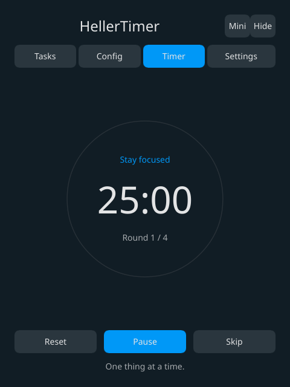

# HellerTimer

[](https://slint.dev)
[](https://github.com/hlophlopgaming/HellerTimer/actions/workflows/check.yml)
[](LICENSE)

[English](README.md) · [Русский](README.ru.md) · [Deutsch](README.de.md) · [Español](README.es.md) · [Français](README.fr.md) · [Português](README.pt.md) · [Italiano](README.it.md) · [中文](README.zh.md) · [日本語](README.ja.md)

Нативный таймер Pomodoro на **Rust + Slint**, вдохновлённый [Pomatez](https://github.com/zidoro/pomatez). Назван в честь Джозефа Хеллера, автора «Уловки-22».

Таймер и десктопный интерфейс работают; веб-версия — демо, основное приложение — десктопное.

[Скачать релизы](https://github.com/hlophlopgaming/HellerTimer/releases) · [Сайт и веб-демо](https://hlophlopgaming.github.io/HellerTimer/) · [Сборки](https://github.com/hlophlopgaming/HellerTimer/actions)

<p align="center"></p>
<p align="center"></p>

## Возможности

- Фокус, короткие и длинные перерывы; настраиваемые раунды; четыре плановых особых перерыва.
- Строгий режим, автозапуск фокуса, опциональные полноэкранные перерывы и дополнительные предупреждения.
- Абсолютные дедлайны на `SystemTime`: пропущенные переходы воспроизводятся после сна, озвучивается только последний переход.
- Списки задач с заголовками, описаниями, отметкой выполнения, перестановкой и переносом между списками. Enter сохраняет правки; стрелки меняют порядок, → переносит в следующий список. Удаляются только пустые списки.
- Интерфейс на английском и русском (и ещё семи языках), встроенный Noto Sans с кириллицей, пять тем (Light, Dark, Paper, Forest, Midnight) и оригинальные звуки/голос Pomatez.
- Оригинальная иконка-песочные часы, вдохновлённая «Уловкой-22».
- Трей с прогрессом, компактное мини-окно, поверх окон, системный/свой заголовок, закрытие/сворачивание в трей, один экземпляр и автозапуск.
- Опциональная проверка обновлений через 30 секунд после старта с таймаутом запроса 5 секунд. Для запуска и работы таймера сеть не нужна.
- Атомарное версионированное хранилище JSON и отложенное сохранение на 500 мс. Повреждённый файл резервируется как `data.json.bak`.
- Программный рендеринг по умолчанию; опционально FemtoVG для сравнений. Один single-shot таймер планирует пробуждения ядра; без воркер-потока таймера и async-рантайма.

## Статус платформ

| Возможность | Linux | Windows | macOS | Web | Android |
|---|---|---|---|---|---|
| Таймер, задачи, конфиг, переводы | проверено локально | сборка CI | сборка CI | WASM проверен | проверка SDK/устройства |
| Трей и прогресс | нужен хост StatusNotifier | реализовано | реализовано | — | уведомление-отсчёт |
| Мини-окно / закрепление | зависит от композитора | реализовано | реализовано | в канвасе | в разметке |
| Глобальные горячие клавиши | X11 | реализовано | реализовано | — | — |
| Звук / английский голос | `paplay` | нативный WinMM | `afplay` | звонок после клика | ожидает |
| Системные уведомления | `notify-send` | ожидает; скрыто | `osascript` | разрешение браузера | Java-мост |
| Автозапуск | реализовано | реализовано | реализовано | — | — |

Неподдерживаемые опции скрыты в настройках. В Linux звук и уведомления предлагаются только при наличии нужных утилит; трей требует активного StatusNotifier-наблюдателя. В GNOME обычно нужно расширение AppIndicator. Глобальные горячие клавиши не регистрируются под Wayland. «Поверх окон» там скрыто, так как поддержка зависит от композитора.

Горячие клавиши: **Ctrl+Alt+P** старт/пауза, **Ctrl+Alt+N** пропустить, **Ctrl+Alt+M** мини-окно. Конфликтующие/неподдерживаемые клавиши логируются, приложение остаётся рабочим.

## Установка / запуск

Скачайте пакет из [Releases](https://github.com/hlophlopgaming/HellerTimer/releases). Атрибуция «Made with Slint» и полные лицензионные уведомления прилагаются к пакетам.

```
cargo run -p heller-desktop
cargo run -p heller-desktop -- --start
cargo run -p heller-desktop -- --mini
cargo build --release -p heller-desktop --features femtovg
```

Требуется стабильный Rust 1.92+ и библиотеки Slint/winit. Ubuntu:

```
sudo apt install libxkbcommon-dev libxkbcommon-x11-dev libwayland-dev libfontconfig1-dev libx11-xcb-dev
```

Опциональные утилиты Linux: `pulseaudio-utils` (`paplay`, работает и с PulseAudio-совместимым сервером PipeWire), `libnotify-bin`, `curl` и `busctl` из systemd. Зависимости от GTK нет.

CLI: `--start`, `--hidden`, `--mini`, `--renderer software|femtovg`, `--animation`, `--no-animation`, `--bench-first-frame`, `--help`. FemtoVG требует фичу компиляции выше. `--hidden` откатывается к показу окна, если трей недоступен. Инструментация первого кадра сообщает значение только если рендерер поддерживает уведомитель Slint.

Файл `portable` рядом с исполняемым выбирает соседнюю папку `data/`; иначе используются системные папки конфигов. В переносимых Windows-архивах этот маркер есть. Импорта из Pomatez нет.

Неподписанные macOS-пакеты могут требовать **Open Anyway** в «Настройки → Конфиденциальность и безопасность». Ключей подписи Apple нет. APK подписаны debug до настройки release-keystore.

## Веб и Android

```
rustup target add wasm32-unknown-unknown
cargo check -p heller-web --target wasm32-unknown-unknown
cargo install trunk --locked
cd crates/heller-web
trunk serve
```

Браузерные уведомления требуют разрешения и защищённого источника (HTTPS или localhost); звук — действия пользователя. Скрытые вкладки могут задерживать уведомления из-за троттлинга; оставшееся время пересчитывается из дедлайнов при возврате. Тема сохраняется локально. Тёмные/светлые настройки версии 1 мигрируют в версию 2 без потери задач и конфига. Хранилище может быть недоступно в приватных сессиях; ошибки логируются. PWA-манифест даёт отдельную установку; офлайн-кэш не реализован.

Android: нужны Java 17, Android SDK platform 35, NDK и Gradle 8.11.1. Установите `cargo-ndk`, добавьте три Rust-таргета Android, затем по `.github/workflows/release.yml` соберите JNI-библиотеки и запустите `gradle assembleDebug` в `crates/heller-android/android`. Запрет точного будильника откатывается к неточному; разрешение уведомлений запрашивается на Android 13+. Java-приёмник может объявить следующий дедлайн без UI-процесса. **Продолжение нескольких фаз после смерти процесса не реализовано:** откройте приложение заново. Сборки Android и IME требуют проверки на реальном устройстве.

## Проверка

```
cargo fmt --all -- --check
cargo check --workspace
cargo clippy --workspace -- -D warnings
cargo test -p heller-core
cargo check -p heller-web --target wasm32-unknown-unknown
cargo check -p heller-android --target aarch64-linux-android
python bench/bench.py --help
python -m unittest discover -s bench
```

Для проверки реальных контролов Slint и размеров окна в графической сессии:

```
cargo run -p heller-desktop --example ui-smoke
cargo run -p heller-desktop --example ui-smoke -- --start-mini
cargo run -p heller-desktop --example ui-smoke -- --frameless
```

Эти сценарии шлют события указателя, проверяют все входы мини-окна и восстановление (включая скрытые окна), передачу нативного перетаскивания и отпускание указателя, контролы таймера, задачи, конфиг, все темы, русский язык и персистентность. Используется in-memory платформа, пользовательские данные не меняются. Скриншоты RGBA и размеры идут в `$HELLER_SCREENSHOT_DIR` или временную папку `hellertimer-ui-smoke`. CI гоняет те же сценарии под Xvfb.

Последняя Android-команда требует SDK/JDK даже для `cargo check`. Долгие задачи упаковки и релиза выполняются в CI. Push тега `v*` собирает пакеты релиза; workflow сразу публикует обычный релиз с пометкой Latest и затем прикладывает пакеты после успешных сборок. GitHub Pages разворачивается из `main` через Actions. PR не требуется.

## Производительность

См. [инструкцию бенчмарка](bench/README.md). Цели: ≤30 МиБ видимого PSS, ≤20 МиБ PSS в трее, почти нулевой скрытый CPU, ≤250 мс запуска. Оба рендерера сравниваются с полным деревом процессов Pomatez на одной машине.

<!-- bench:start -->
Измерено на десктопном Linux против Pomatez 1.11.0 (всё дерево процессов, PSS). См. [инструкцию бенчмарка](bench/README.md). График — [SVG](site/bench/benchmark.svg).

| Application | Scenario | Private MiB | CPU % |
|---|---|---:|---:|
| HellerTimer/software | idle-visible | 16.9 | 0.00 |
| HellerTimer/femtovg | idle-visible | 51.9 | 0.00 |
| HellerTimer/software | running-static | 17.3 | 0.07 |
| HellerTimer/femtovg | running-static | 49.6 | 0.10 |
| HellerTimer/software | mini | 15.9 | 0.00 |
| Pomatez | idle-visible | 301.5 | 1.07 |
<!-- bench:end -->

Встроенный трей Slint использует ksni в Linux; его внутренние зависимости вне чистого ядра таймера. Нативные аудио-хелперы работают только во время эффектов и освобождают устройство. Мини-режим переиспользует главное окно. Видимая интерполяция прогресса опциональна и по умолчанию выключена.

## Оставшаяся работа по паритету

Эта реализация ещё не полностью удовлетворяет полному определению готовности из PLAN.md: точный визуальный паритет, drag-and-drop задач и меню произвольного переноса, следование системной теме, отдельный компактный макет, системные уведомления Windows, голос в браузере/Android, звук Android и продолжение фаз после смерти процесса, автоматизация бенчмарков холодного старта и размера, универсальные macOS-сборки/подпись/нотаризация и проверка на устройствах. Смещения особых перерывов вычисляются при запуске; перезапустите после смены часового пояса/DST. Сессии таймера не переживают перезапуск процесса.

## Лицензия и атрибуция

Исходный код: [MIT](LICENSE). Slint используется по [Slint Royalty-free License 2.0](assets/licenses/Slint-Royalty-free-2.0.md), с виджетом AboutSlint в настройках и атрибуцией рядом с загрузками. [Сторонние уведомления](THIRD_PARTY.md) покрывают MIT-ассеты Pomatez, Noto Sans (OFL) и прямые зависимости. Спасибо Pomatez и авторам Slint.
